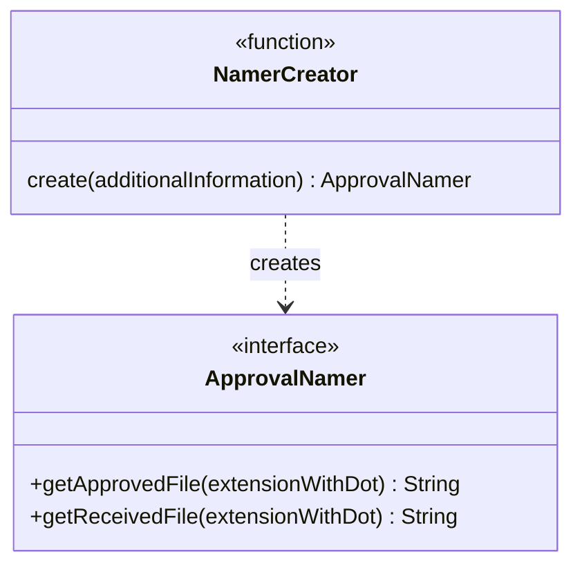
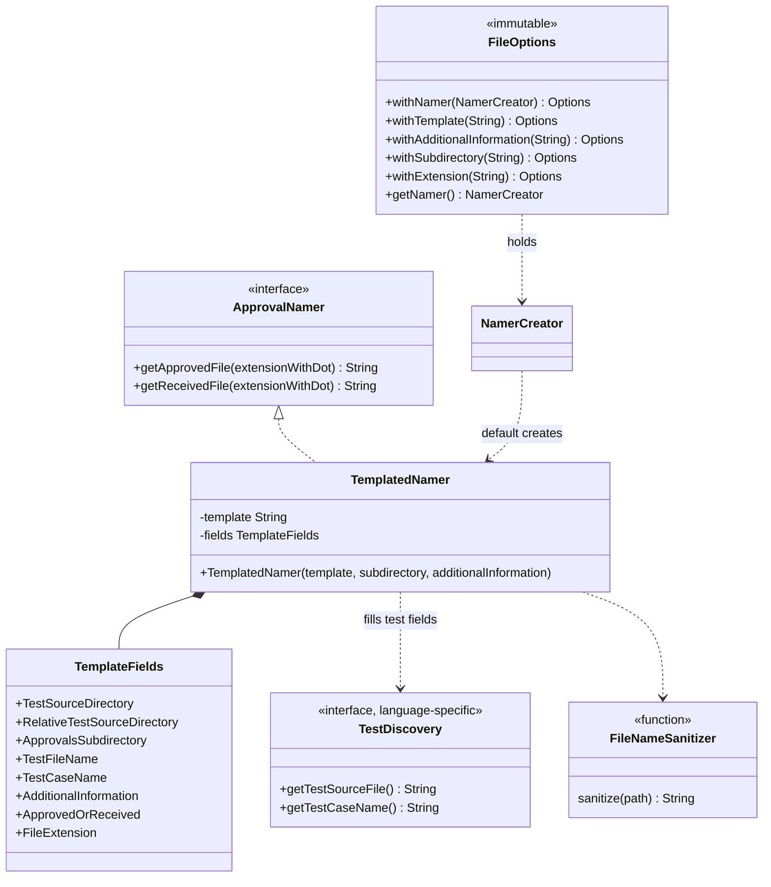

# Desired Namer Architecture

This is a proposed, language-neutral namer design based on the Go implementation. Go has the simplest working design of the five implementations we analyzed.

- one small interface;
- a factory that creates a namer for each `verify`;
- one template-based namer as the default.

The only part that has to be language-specific is how the current test is found.

## Goals

- **One small interface.** It has the two path methods that C++ and Go share.
- **The namer builds the full path**, including the extension, which is passed in.
- **The default namer is a template.** There are no special-case namers for each layout.
- **Everything the namer needs comes from immutable Options**: additional information, subdirectory, extension, and template. There are no thread-local values, ambient scopes or globals.
- **The creator takes only the additional information.** The template and subdirectory are fixed when the creator is built. The extension is passed to the path methods.
- **Test discovery is a separate, replaceable piece**, so the rest of the design is the same in every language.

## The Interface



| Member | Purpose |
|---|---|
| `getApprovedFile(ext)` | Full path to the approved file |
| `getReceivedFile(ext)` | Full path to the received file |
| `NamerCreator` | Builds a fresh namer for each `verify` call from that call's additional information. Go calls this `ApprovalNamerCreator`. |

## Types



## The Default Template

```text
{TestSourceDirectory}/{ApprovalsSubdirectory}/{TestFileName}.{TestCaseName}{AdditionalInformation}.{ApprovedOrReceived}.{FileExtension}
```

| Field | Value |
|---|---|
| `{TestSourceDirectory}` | Directory of the test source file |
| `{RelativeTestSourceDirectory}` | That directory, relative to the project root |
| `{ApprovalsSubdirectory}` | Subdirectory given to the creator. Empty by default; the resulting empty path segment is collapsed. |
| `{TestFileName}` | Test source file name without its extension |
| `{TestCaseName}` | Test name. Nested names (subtests, sections, inner classes) are joined with `.` |
| `{AdditionalInformation}` | `.` + each additional-information value, or empty |
| `{ApprovedOrReceived}` | `approved` or `received` |
| `{FileExtension}` | Extension without the dot |

Result: `tests/MyTests.adds_numbers.approved.txt`, or `tests/approvals/MyTests.adds_numbers.3_4.approved.txt` with a subdirectory and a parameter.

