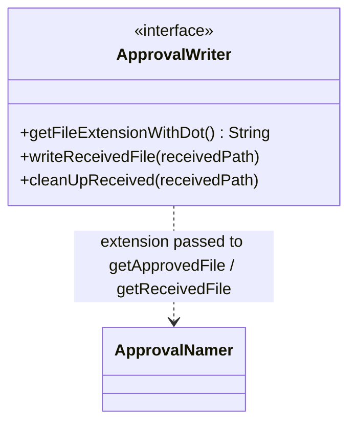
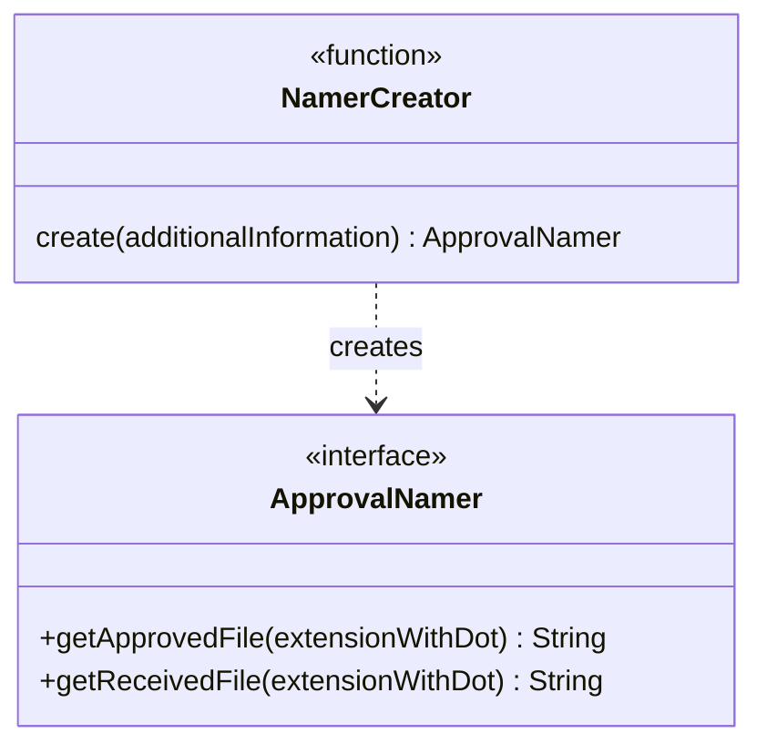
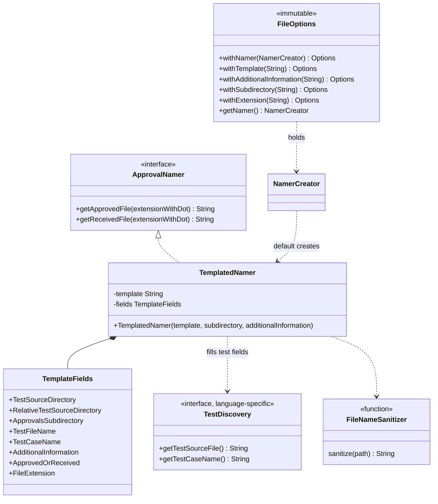

# Desired Namer Architecture

This is a proposed, language-neutral namer design based on the Go implementation. Go has the simplest working design of the five implementations we analyzed.

- one small interface;
- a factory that creates a namer for each `verify`;
- one template-based namer as the default.

The only part that has to be language-specific is how the current test is found.

## The Writer

The writer follows C++, with Java's method name for writing.



| Member | Purpose |
|---|---|
| `getFileExtensionWithDot()` | The extension for both files. The approver passes it to the namer's path methods. Text writers take it from `FileOptions.withExtension(...)`. |
| `writeReceivedFile(receivedPath)` | Writes the received output to the path the namer chose. |
| `cleanUpReceived(receivedPath)` | Removes the received file after a pass. Writers that wrap an existing file can leave it in place. |

The writer never builds file names; that is the namer's job.

| Language | Today | Change needed |
|---|---|---|
| C++ | `getFileExtensionWithDot`, `write`, `cleanUpReceived` | Rename `write` to `writeReceivedFile` |
| Java | `getFileExtensionWithDot`, `writeReceivedFile` (returns `File`) | Add `cleanUpReceived` |
| .NET | `GetApprovalFilename`, `GetReceivedFilename`, `WriteReceivedFile` | Move file naming to the namer; add `GetFileExtensionWithDot` and `CleanUpReceived` |
| Python | `write_received_file`; extension comes from Options | Add `get_file_extension_with_dot` and `clean_up_received` |
| Go | No writer; `Verify` takes an `io.Reader` and the extension comes from Options | Add an `ApprovalWriter` interface |

## Goals

- **One small interface.** It has the two path methods that C++ and Go share.
- **The namer builds the full path**, including the extension, which is passed in.
- **The default namer is a template.** There are no special-case namers for each layout.
- **Everything the namer needs comes from immutable Options**: additional information, subdirectory, extension, and template. There are no thread-local values, ambient scopes or globals.
- **The creator takes only the additional information.** The template and subdirectory are fixed when the creator is built. The extension is passed to the path methods.
- **Test discovery is a separate, replaceable piece**, so the rest of the design is the same in every language.

## The Interface



| Member | Purpose |
|---|---|
| `getApprovedFile(ext)` | Full path to the approved file |
| `getReceivedFile(ext)` | Full path to the received file |
| `NamerCreator` | Builds a fresh namer for each `verify` call from that call's additional information. Go calls this `ApprovalNamerCreator`. |

## Types



## The Default Template

```text
{TestSourceDirectory}/{ApprovalsSubdirectory}/{TestFileName}.{TestCaseName}{AdditionalInformation}.{ApprovedOrReceived}.{FileExtension}
```

| Field | Value |
|---|---|
| `{TestSourceDirectory}` | Directory of the test source file |
| `{RelativeTestSourceDirectory}` | That directory, relative to the project root |
| `{ApprovalsSubdirectory}` | Subdirectory given to the creator. Empty by default; the resulting empty path segment is collapsed. |
| `{TestFileName}` | Test source file name without its extension |
| `{TestCaseName}` | Test name. Nested names (subtests, sections, inner classes) are joined with `.` |
| `{AdditionalInformation}` | `.` + each additional-information value, or empty |
| `{ApprovedOrReceived}` | `approved` or `received` |
| `{FileExtension}` | Extension without the dot |

Result: `tests/MyTests.adds_numbers.approved.txt`, or `tests/approvals/MyTests.adds_numbers.3_4.approved.txt` with a subdirectory and a parameter.

## Java status (32.0.0)

Java now matches the interface and the creator. The rest of the gaps are listed below in the order we would close them.

### Done

| Goal | Java |
|---|---|
| One small interface | `ApprovalNamer` has only `getApprovedFile(ext)` and `getReceivedFile(ext)`. They return `File`, not `String`. |
| The namer builds the full path | Both methods resolve the whole template, including the extension. |
| The default namer is a template | `StackTraceNamer` resolves `TemplatedCustomNamer.DEFAULT_TEMPLATE`. `MasterDirectoryNamer` and `VelocityApprovals` build on `getApprovedFile` through `NamerUtils`. |
| A creator per `verify` | `Options.forFile().withNamer(additionalInformation -> namer)`. The global `Approvals.namerCreater` is gone. |
| Additional information comes from Options | `Options.forFile().withAdditionalInformation(...)` and `Approvals.NAMES`. The `NamerFactory` thread-local and `NamedEnvironment` are gone. |
| Custom templates | `TemplatedCustomNamer.create(template)` returns a namer. `withBaseName`, `withName` and `NamerWrapper` are gone. |

### Remaining

| Gap | Today | Desired |
|---|---|---|
| Name of the default namer | `StackTraceNamer`, with the template passed as a second constructor argument | `TemplatedNamer` |
| Subdirectory from Options | Read from package settings through `NamerFactory.getSubdirectory()` when the namer is created | `FileOptions.withSubdirectory(...)`, fixed when the creator is built |
| Template from Options | `withNamer(TemplatedCustomNamer.create(template))` | `FileOptions.withTemplate(...)` |
| Test discovery is separate | Built into `StackTraceNamer` through `TestUtils.getCurrentFileForMethod` | A `TestDiscovery` piece the namer depends on |
| `getNamer()` | Returns an `ApprovalNamer` | Returns the `NamerCreator` |
| File name sanitizing | None | `FileNameSanitizer` |
| Java-only field | `APPROVAL_BASE_DIRECTORY` (`NamerFactory.getApprovalBaseDirectory()`) moves `{TestSourceDirectory}` | Decide whether it becomes an Options value or part of `{TestSourceDirectory}` |

Upgrade guides for users: [31.2.0 to 31.3.0](../approvaltests/docs/how_to/Upgrade.V31.2.0.to.V31.3.0.md) and [31.3.0 to 32.0.0](../approvaltests/docs/how_to/Upgrade.V31.3.0.to.V32.0.0.md).
