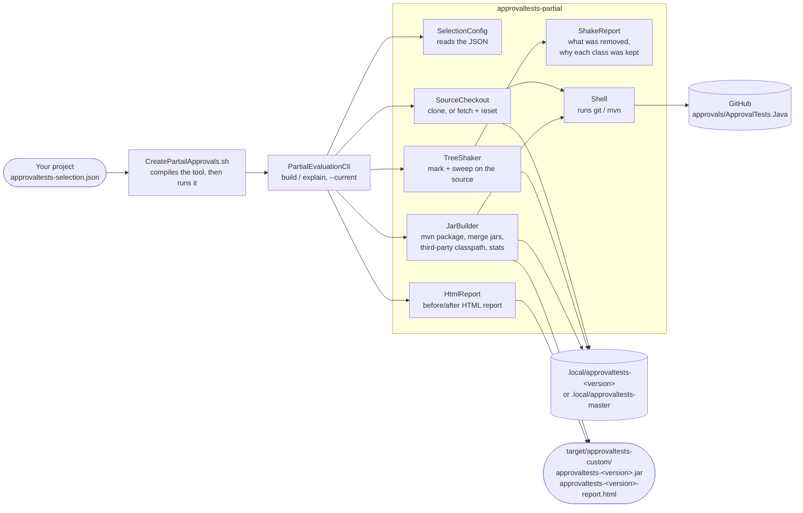
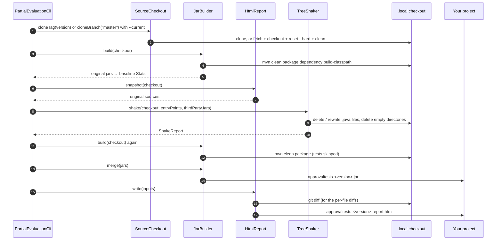
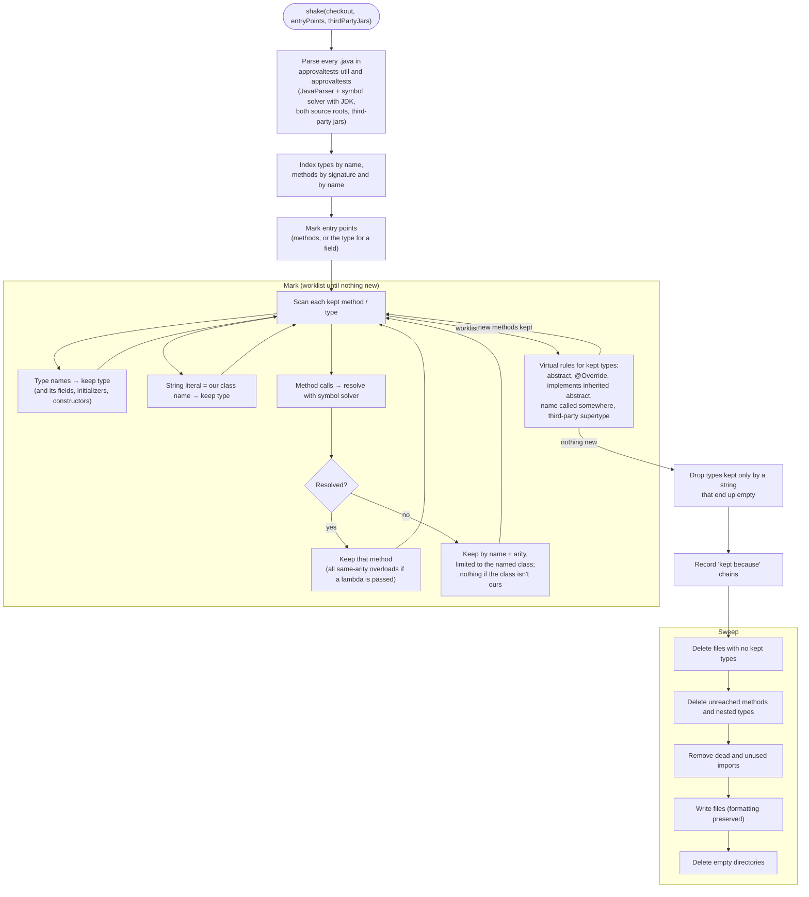
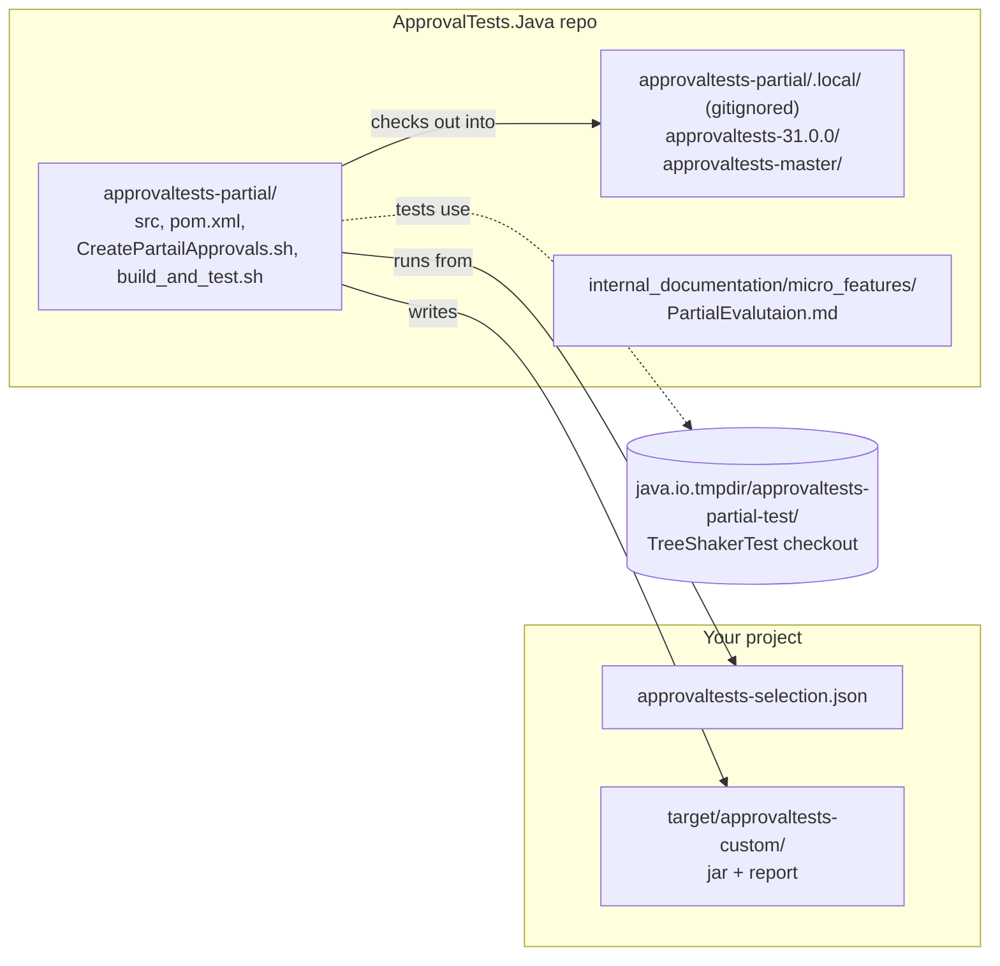

# Partial Evaluation Architecture

How the `approvaltests-partial` tool is put together. For what it does and why, see [PartialEvalutaion.md](PartialEvalutaion.md).

All code lives in `approvaltests-partial/src/main/java/org/approvaltests/partial/`.

## Components

| Class | Responsibility |
|---|---|
| `PartialEvaluationCli` | Parses `build` / `explain` / `--current` / `--config`, and runs the pipeline. |
| `SelectionConfig` | The `approvaltests-selection.json` model (version, entry points, runtime discoveries, output). |
| `SourceCheckout` | Gets the source: shallow-clone a tag or `master`, or fetch and `reset --hard` an existing checkout. |
| `JarBuilder` | Runs Maven on `approvaltests-util` + `approvaltests`, writes their third-party classpath, merges the two jars into one, and measures jars. |
| `TreeShaker` | Parses the source with JavaParser + symbol solver, marks what is reachable, and deletes the rest in place. |
| `ShakeReport` | Results of a shake: deleted files and directories, removed methods and types, and the "kept because" chain for every kept class. |
| `HtmlReport` | Compares the original source snapshot with the shaken checkout, and writes the HTML report. |
| `Shell` | Runs `git` and `mvn` processes. |

## Build Pipeline

`explain` runs steps 1–2, builds only if the third-party classpath is missing, shakes, and prints `ShakeReport.keptBecause` for classes matching the prefix. It does not build the partial jar.

## Tree Shaking

## Where Things Live

- **Checkouts:** `.local/` sits inside the repo so you can browse the shaken code. `CheckedExceptionsTest` skips `.local` folders, because it scans the repo for ApprovalTests sources.
- **Tests:** `TreeShakerTest` clones this repo's own `31.0.0` tag from the local path into the temp directory, so it runs offline.
